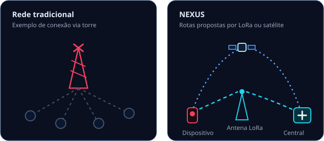

# NEXUS | Front-End Design Engineering

Projeto acadêmico da Global Solution 2026/2 (CitizenTech), FIAP. O NEXUS explora como registrar um pedido de socorro durante uma enchente e mostrar o estado do pedido ao cidadão.

## Três partes distintas

- **Site institucional.** Este pacote contém sete páginas em HTML, CSS e JavaScript puros. O site pode ser aberto sem executar o servidor do WebChat.
- **Simulador visual de rotas.** A página Como funciona usa um grafo e Dijkstra para ilustrar alternativas por antenas LoRa ou satélite. É uma simulação em memória. O mapa e seus tempos não são medidos em campo, o envio é fictício e, após a perda de todas as rotas, a nova tentativa é manual.
- **WebChat local.** Com o NEXUS em execução, o usuário informa os dados de um SOS fictício, confirma o relato e recebe um protocolo. Sem rota, o SOS fica salvo no computador. Ao testar uma rota simulada, o mesmo protocolo passa a recebido pela central simulada. O WebChat não aciona resgate. LoRa, satélite, GPS automático e uma central operacional fazem parte da visão futura, não da implementação atual.

## Como executar e testar

1. Extraia o ZIP inteiro e abra `index.html` no navegador. Se preferir, sirva a pasta com `python3 -m http.server 8000` e abra `http://127.0.0.1:8000`.
2. Na página **Como funciona**, use **Enviar alerta**, **Simular falha de conexão** e **Restaurar rede**. Para mostrar o estado sem rota, desative as três conexões que saem do dispositivo de origem e tente enviar. Restaure uma delas e tente novamente.
3. Confira o menu em 390, 768 e 1440 px, as abas de Tecnologias, o filtro do FAQ e a validação de Contato. Use dados fictícios. O formulário não envia mensagens.
4. Para a demo do WebChat, siga o README na raiz do repositório oficial. Com o serviço rodando no computador, abra `http://127.0.0.1:1880/nexus/`.

## Tecnologias e estrutura

- HTML5 semântico e CSS3 externo, com Flexbox, Grid e Media Queries.
- JavaScript puro, em arquivos externos. SVG para ícones, ilustrações e o mapa demonstrativo.
- Inter e Space Grotesk são fontes opcionais do Google Fonts. O CSS usa fontes do sistema quando estiver offline.
- Git e GitHub registram a evolução do projeto.

| Arquivo ou pasta | Conteúdo |
| --- | --- |
| `index.html`, `sobre.html`, `integrantes.html`, `faq.html`, `contato.html` | Cinco páginas obrigatórias |
| `solucao.html`, `tecnologia.html` | Duas páginas sobre a solução, com simulador e abas |
| `css/`, `js/`, `assets/` | Estilos, interações e recursos visuais |
| `integrantes.txt` | Identificação acadêmica |
| `APRESENTACAO_PRESENCIAL.md` | Guia para apresentar e demonstrar o projeto |

## Imagens do projeto

Ilustrações conceituais do site. Não representam equipamentos instalados ou transmissão real.

## Autores

| Nome completo | RM | Turma | GitHub | LinkedIn |
| --- | --- | --- | --- | --- |
| Octavio de Souza Ribeiro | 576074 | 1TDSPA | [Perfil](https://github.com/octavioribeiro914-cyber) | A confirmar |
| Ethan Suganuma Figueiredo | 575763 | 1TDSPA | [Perfil](https://github.com/Ethan172k) | [Perfil](https://www.linkedin.com/in/figueiredoethan/) |

## Repositório e contato

- [Repositório oficial do NEXUS](https://github.com/Ethan172k/nexus). O ZIP contém a revisão do site. Compare-a com a versão publicada antes de entregar.
- [Contato pelo perfil do Ethan](https://www.linkedin.com/in/figueiredoethan/) ou pela [página de integrantes](integrantes.html). O formulário do projeto é demonstrativo.

## Uso de IA generativa

Ferramentas de IA foram usadas como apoio à estruturação, revisão técnica e redação. A equipe deve revisar o resultado e explicar como funcionam as partes que apresentar.
